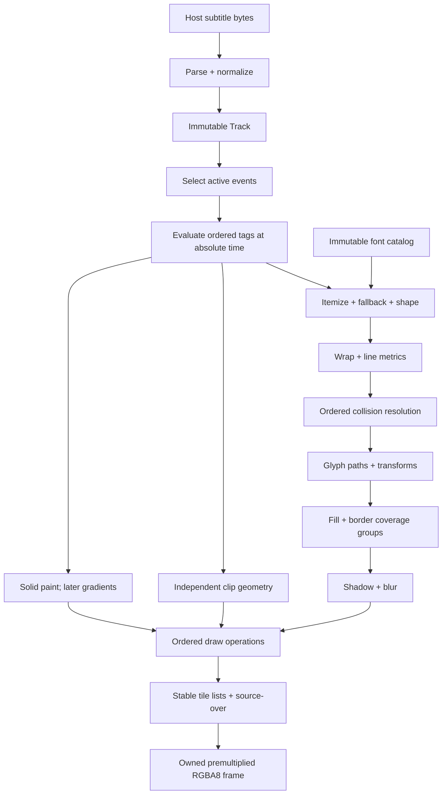
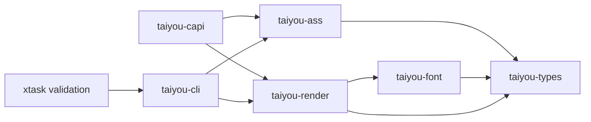

# Architecture

Status: accepted design v0.1, not a claim of implemented functionality. Normative representations live in [contracts](CONTRACTS.md); cache fields in [caching](CACHING.md). Research gates may refine private algorithms but may not silently change these interfaces.

## A1. Design in one page

Use a Rust workspace with a small shared types crate, a parser crate, a rendering crate with private stage modules, a narrow native font adapter, a C ABI crate and a headless CLI. Avoid a crate per algorithm. Immutable, typed artifacts form a directed pipeline. A frame coordinator owns ordering and budgets; expensive independent work can later run on a renderer-owned work-stealing pool. Geometry, A8 coverage and paint remain separate until composition.

The initial reference implementation is single-worker and scalar outside mature native libraries. Use HarfBuzz for shaping, FreeType for outline extraction and initial grayscale rasterization, Rust Unicode libraries for bidi/script analysis, and Rayon only when parallel work is demonstrated useful. Versions and binding choices are frozen in T002. A compatibility raster/stroke backend is a bounded experiment, not an assumption that FreeType will match VSFilter pixels.

## A2. Pipeline

Selection, evaluation and shaping operate in logical text order. Layout applies visual bidi order per line. Collision is a serial barrier. **Effects operate on complete coverage groups before tile composition**, so tile edges cannot truncate blur. Clip is applied to effected coverage at composition, not destructively to the cached source mask. Integer placement is an operation attribute; fractional placement is part of rasterization.

## A3. Modules and allowed dependencies

All paths below are planned. Arrows mean “may import”; reverse imports are forbidden.

`taiyou-render` accepts `Track` from types; it never reparses ASS strings. `taiyou-font` exposes immutable data and a private worker-local context, never native pointers. CLI is the sole initial filesystem boundary; rendering never searches a directory, fetches a URL or decodes an image named in a tag.

| Planned module | Owns / output | Allowed internal inputs | Test owner / extension boundary |
|---|---|---|---|
| types: units, track, scene, errors | Value types, immutable IR, checked constructors | std only initially | T003; versioned fields |
| ass: decode, sections, styles, events, overrides | UTF-8 source, spans, normalized Track | types | T004–T006/T026; new frontend may emit same IR |
| render: evaluate | Effective runs, temporal paint/geometry state | types | T007/T020/T022; new operations compile here |
| font: catalog, native, shape | Font snapshots, metrics, positioned glyph runs, outlines | types, FreeType, HarfBuzz, Unicode libraries | T008/T009; host fonts and later providers |
| render: layout, collision | Relative line boxes; placed events | types, font outputs | T010/T017; ruby/curves remain later stages |
| render: geometry, drawing | Color-free paths and transformed contours | types, font | T011/T021/T023; glyph deformation seam |
| render: raster, stroke | A8 fill/expanded masks per coverage group | geometry, types, font raster adapter | T012/T016; backend-private algorithm |
| render: effects, clip | Filtered A8 masks, clip coverage | types, raster | T018/T021; finite-support filter chain |
| render: paint | Color at pixel/sample and coordinate mapping | types | T013; gradients/image fills later |
| render: compose | RGBA8 tiles and final buffer | masks, paint, types | T013/T025; future isolated groups |
| render: cache | Typed stores, byte accounting and statistics | types, immutable stage artifacts | T019/T024; no stage calls from cache |
| render: scheduler, renderer | Frame DAG, budgets, barriers, lifetime | all render modules, font | T014/T024; one pool, no global pool |
| capi | Opaque handles, validated buffers/status | public ass/render/types | T028; ABI v1 after release gate |
| cli | Explicit files/fonts/time/output and diagnostics | public ass/render | T014/T027; FFmpeg/mpv adapter later |
| xtask, validation | Corpus manifests, adapters, reports, benchmarks | public output; never production dependency | T005/T015/T029/T030 |

## A4. Ownership and frame transaction

`Arc<Track>` and `Arc<FontCatalog>` are immutable snapshots. Edits create new revisions. Renderer configuration is fixed for its lifetime; resizing is a frame request. A renderer has exclusive mutable access during `render(&mut self, ...)`; callers serialize calls to one renderer and may create independent renderers. Font bytes outlive native faces through owned `Arc<[u8]>` references. No self-referential borrowed native objects escape adapters.

A frame transaction selects events in source order, evaluates and prepares them, solves collision, generates coverage groups and draw operations, then composes. It publishes a complete owned `Frame` only on success. Failure releases temporary allocations and returns a typed error; it never returns a silently partial image. Tolerated malformed input yields stable diagnostics attached to the track/frame. Native out-of-memory failures and checked allocation failures become errors; catastrophic process OOM is not claimed recoverable everywhere.

Cache eviction drops cache ownership only. Existing frames and operations retain their data. Frame output owns pixels independently of renderer, track and caches; it remains readable after their destruction. Scratch buffers are private to the executing worker, reset per job, bounded, and never retained by artifacts.

## A5. Execution and determinism

Initial execution is sequential. Later, `workers=1` executes inline without a pool; `workers=N>1` creates exactly N pool workers and the caller only coordinates/waits. Default stays 1 until measurements justify an automatic policy. A host with many renderers sets their counts explicitly. There is no nested global Rayon pool or parallelism inside native font calls.

| Step | Parallel permission | Ordering invariant |
|---|---|---|
| Decode/parse one track | Sequential initially | Source byte order and stable EventId |
| Active event evaluation/shaping/layout | Independent event jobs | Store results by EventId, never completion order |
| Collision | Serial within layer | Canonical order and pure recomputation on seek |
| Geometry/masks/effects | Unique-key dependency jobs | One producer per key per frame; dependents run after producers |
| Paint sampling | Per operation/tile | Coordinate calculation independent of traversal |
| Composition | Disjoint tiles | Same ordered operations for each pixel |
| Cache publication/eviction | Coordinator at barriers | Stable admission/eviction ties; no visual effects |

Use an explicit batch DAG: collect equal requests, resolve hits, enqueue unique misses, publish, then advance the stage. Workers never wait for work queued to the same saturated pool. This avoids single-flight deadlock and expensive duplicate work. Small events are batched by estimated glyph/path count; large blur is one job initially, not recursively split. Independent large masks can run concurrently. Profiling may justify row-parallel blur with a pass barrier, but not before T024 evidence.

Provisional tile size is 64×64, an implementation choice measured in R003. Build per-tile operation-index lists by stable traversal of the full ordered list. No atomics on pixels; one task owns each disjoint region. Source-over is not associative under finite precision: do not regroup operations or sum alpha in parallel. Coverage-group union is likewise specified by profile before parallelization.

Scheduling thresholds use deterministic work estimates, not completion timing. Parallel and serial modes use identical numeric kernels. Required determinism is byte equality across workers/cache modes for the same dependency build, target and CPU path; cross-platform equality is separately measured and never presumed from that guarantee.

## A6. Extension seams

| Feature | Change location | Preserved artifacts |
|---|---|---|
| Gradients/per-vertex alpha | Paint + paint-space mapping; tests | Paths and A8 coverage |
| Multiple borders | Ordered `CoveragePass` list, distinct width keys | Base outline and fill |
| Curved text | Post-layout per-glyph placement, before raster | Shaping clusters and outlines |
| Furigana | Layout annotation groups with base/ruby metrics | Independent shaped runs |
| Distortion/perspective | Geometry mapping before raster; bounded tessellation | Font outlines and logical layout |
| Advanced compositing | Explicit isolated surface groups in scene | A8 masks; existing source-over remains default |
| Mangetsu or `.asa` | New versioned frontend/lowering rules | Track-independent scene stages |

These are design seams, not implemented features or a runtime plugin interface. Do not allocate hypothetical payloads now. Color-only changes must not reshape, transform or rasterize. Paint may depend on glyph-local, event-local or device coordinates; its explicit space prevents accidentally treating moved gradients as constant colors.

## A7. Main risks and gates

Version-specific ASS semantics come directly from pinterf/xy-VSFilter source with focused regression coverage; R003 sets cost thresholds; R004 handles only complex transform questions that remain ambiguous after source inspection. Native packaging, GDI versus FreeType metrics, font fallback, overlapping translucent glyphs, fractional placement and blur support are major compatibility risks. No single engine is authoritative for all of these. See [ADRs](decisions/README.md), [compatibility](COMPATIBILITY.md) and the [roadmap](ROADMAP.md).
