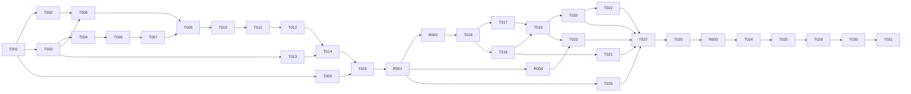

# Implementation roadmap

All phases are planned. A gate requires observable results, not just compilation. See [task specifications](tasks/README.md) for exact scope and dependencies. Source paths and Rust commands are planned until their creating task lands. The blueprint itself supplies documentation, reference revision pins and a structural checker only.

## P0. Foundation and trustworthy evidence

Tasks: [T001](tasks/T001.md) workspace → [T002](tasks/T002.md) dependencies and [T003](tasks/T003.md) shared types; [T005](tasks/T005.md) inventory/protected validation can proceed alongside independent foundation work.

Gate: dependency graph checked, CLI version/not-implemented behavior proven, typed arithmetic invariants tested, exact native recipes reproduced on three OS targets, corpus assets inventoried/hashed and validation protection actually configured. Missing GitHub owner/remote access keeps the protection gate open; local implementation can continue with clearly provisional results. No published compatibility baseline is trusted before T005 completes.

## P1. Parse and prepare text

Tasks: [T004](tasks/T004.md) ASS records → [T006](tasks/T006.md) overrides → [T007](tasks/T007.md) static evaluation. [T008](tasks/T008.md) catalog/native ownership can proceed after T002/T003; then [T009](tasks/T009.md) shaping → [T010](tasks/T010.md) hard-break layout.

Gate: minimal script produces exact immutable events and state; fixed-font Latin/Arabic/Indic/combining/fallback samples produce owned glyph/cluster layouts; malformed data is bounded. No rendering speed claim yet. Legacy profile still gated.

## P2. First drawable vertical slice

Tasks: [T011](tasks/T011.md) paths/2D geometry → [T012](tasks/T012.md) fill masks; [T013](tasks/T013.md) scalar paint/composition can begin after T003; [T014](tasks/T014.md) integrates CLI. [T015](tasks/T015.md) adds external adapters and full reports after T005/T014.

Gate: fixed-font ASS → raw premultiplied RGBA and PNG at requested time; position/alignment/hard breaks/color and transparent/end-exclusive cases pass. Single-worker, cache off. Comparator produces known-correct difference metrics and accounts for the full external inventory. This is the architecture proof and first usable **development** slice, not the compatibility release.

## P3. Establish historical rules and static effects

Tasks: [R001](tasks/R001.md) approved legacy behavior; [R002](tasks/R002.md) raster/stroke/blur decision → [T016](tasks/T016.md) borders/shadows → [T017](tasks/T017.md) wrapping/collision and [T018](tasks/T018.md) scalar effects. [R004](tasks/R004.md) resolves complex transforms in a separate research lane after R001/T011.

Gate: each enabled LegacyXyV1 family has an approved rule, capture/source provenance and fixtures; borders, shadows, blur and collisions obey that subset. R002 may keep some coverage families unsupported instead of forcing an incorrect algorithm. Research that lacks its environment produces a documented open gate, not invented answers. No concurrency yet.

## P4. Reuse and timed ASS behavior

Tasks: [T019](tasks/T019.md) caches → [T020](tasks/T020.md) move/fade/t → [T022](tasks/T022.md) karaoke. [T021](tasks/T021.md) drawings/clips after T011/T018/R001; [T023](tasks/T023.md) complex transforms after R004/T019; [T026](tasks/T026.md) SSA/explicit decoding after R001/T006/T008. [T027](tasks/T027.md) integrates the headless supported subset.

Gate: all cache mutation rows match fresh-renderer output; timed sequences match random seeks; masks survive color/clip-only changes as specified; all supported ASS/SSA examples run headless on each platform. Full compatibility report exposes remaining unsupported features. This is the single-worker usable candidate and required baseline before optimizing execution.

## P5. Measured parallelism and initial release

Tasks: [T029](tasks/T029.md) performance/KFX corpus → [R003](tasks/R003.md) controlled experiments → [T024](tasks/T024.md) parallel preparation → [T025](tasks/T025.md) tiles → [T028](tasks/T028.md) C ABI → [T030](tasks/T030.md) release verification.

Gate: identical output/diagnostics for 1/2/4/8 workers and cache modes, tile-size invariance, no redundant same-key construction, bounded memory and no observed deadlocks; controlled before/after data including small-workload overhead. C/C++ clients pass lifetime/version/error tests on Windows/Linux/macOS. G2 scope, protection, licensing, full reporting and safety evidence are satisfied. This is the **minimum usable compatibility release**, with declared limitations. FFmpeg/mpv adapters follow as separate tasks; C ABI alone is not proof of those integrations.

## P6. Extensions and selective optimization

Task: [T031](tasks/T031.md) concrete extension lowering/specification. New tasks may then introduce gradients, additional border passes, ruby, curves or distortions independently. SIMD is a new task only after a kernel profile identifies its value and supplies scalar equivalence criteria. No blanket “implement SIMD” task or fabricated `.asa` parser.

Gate: each addition has authoritative syntax, a reviewed stage mapping, invalidation rules, independent fixtures and unchanged existing profile output. Extensions cannot block P0–P5.

## Dependency overview

This diagram shows the main path; task files contain the exhaustive prerequisites checked by the blueprint validator. Shared-contract and file ownership constraints apply even when the DAG permits parallel work.

## First assignment

Give **T001** to Luna 6. Prompt: “Implement docs/tasks/T001.md only. Follow AGENTS.md, preserve the blueprint contracts, prove the workspace graph and explicit CLI not-implemented behavior, and report exact verification results. Do not implement rendering.” Then assign T003 to Luna 6 after T001, with architect review of shared interfaces; Sol 6.1 takes T002 and T008. Astra retains research decisions and risky interface reviews.
